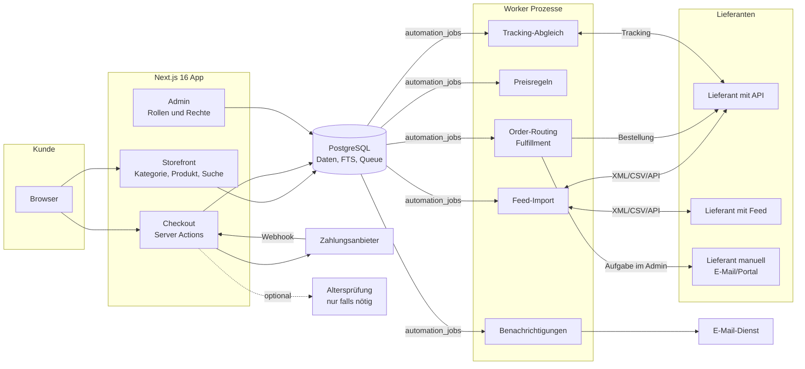
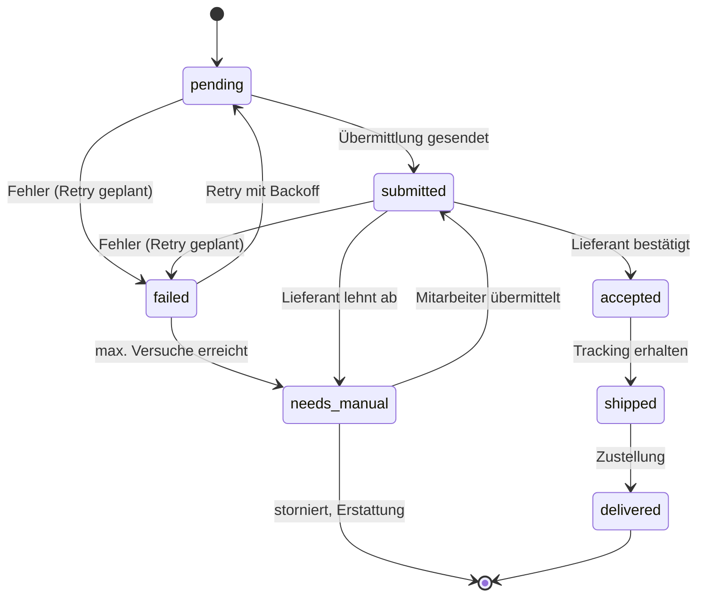

# ARCHITEKTUR DES SHOPS

Name: **Lustviora** (Domain lustviora.de). Deutscher Onlineshop für Erotik- und Wellnessprodukte, Dropshipping von mehreren Großhändlern, hoch automatisiert, ausgelegt auf **100.000+ Produkte**.

Stand: 05.11.2026. Verwandte Dokumente: [LIEFERANTEN.md](./LIEFERANTEN.md), [RECHT-PRUEFLISTE.md](./RECHT-PRUEFLISTE.md).

---

## 1. Tech-Stack

| Bereich | Wahl | Alternative(n) | Begründung |
|---|---|---|---|
| Framework | **Next.js 16 (App Router) + TypeScript** | Remix / React Router, Nuxt | Server Components und statische/ISR-Seiten für 100.000+ SEO-Seiten, Server Actions für Formulare (CSRF-Schutz eingebaut), großes Ökosystem. Remix ist stark bei Formularen, hat aber weniger eingebautes Caching. Nuxt würde Vue statt React bedeuten. |
| Datenbank | **PostgreSQL** | MySQL, MongoDB | Transaktionen für Bestellungen, JSONB für variable Produktattribute, Volltextsuche, `SKIP LOCKED` für Queues. Eine Datenbank für alles im MVP. |
| ORM | **Drizzle ORM** (+ drizzle-kit) | Prisma | SQL-nah, kein separater Query-Engine-Prozess, gute Typen, Migrationen als SQL. Prisma: `latest`-Tag auf npm ist zum 05.11.2026 ein Release Candidate (`8.0.0-rc.30`), daher für Produktion aktuell weniger geeignet. |
| Job-Queue | **Postgres-Queue mit `FOR UPDATE SKIP LOCKED`** (Tabelle `automation_jobs`) | Redis + BullMQ | Keine zusätzliche Infrastruktur, Jobs transaktional mit Bestellungen (Outbox-Muster). Wechsel zu BullMQ erst bei messbarem Bedarf (z. B. sehr hoher Durchsatz, viele Worker). Schnittstelle so abstrahieren, dass der Wechsel lokal bleibt. |
| Suche | **Postgres-Volltextsuche (`german`-Konfiguration)** + `pg_trgm` für Tippfehler | Meilisearch, OpenSearch | Reicht für den Start, keine Synchronisation nötig. Meilisearch (einfach, schnelle Facetten) oder OpenSearch (große Skalierung) als späterer Schritt, wenn Facetten oder Relevanz an Grenzen stoßen. |
| Styling | **Tailwind CSS 4** | CSS Modules | Schnell, konsistent, Design-Tokens. |
| Validierung | **Zod** | Valibot | Feeds, Formulare und API-Eingaben validieren. |
| Feed-Parsing | **fast-xml-parser**, Streaming-CSV | | XML/CSV-Feeds großer Lieferanten. Große Feeds streamend verarbeiten. |
| Tests | **Vitest** | Jest | Schnell, ESM-nativ. Kritisch: Preisregeln, Zustandsautomat, Feed-Mapping. |

---

## 2. Architekturdiagramm

Grundprinzipien:

- **Eine Datenbank** als Quelle der Wahrheit. Jobs werden in derselben Transaktion wie die fachliche Änderung angelegt (Outbox).
- **Lieferanten-Adapter** mit einheitlicher Schnittstelle: `fetchCatalog()`, `fetchStock()`, `submitOrder()`, `fetchShipments()`. Ein Adapter `manual` erzeugt Admin-Aufgaben statt API-Aufrufe.
- **Idempotenz** überall: Webhooks, Bestellübermittlung und Importe dürfen mehrfach laufen, ohne doppelte Wirkung.

---

## 3. Datenbankstruktur

Geldbeträge **immer als Integer in Cent** (`*_cents`), Währung als ISO-Code. Zeitstempel in UTC (`timestamptz`).

| Tabelle | Zweck | Wichtige Felder |
|---|---|---|
| `users` | Kunden und Mitarbeiter | `id`, `email`, `password_hash`, `role`, `created_at`, `marketing_consent_at` |
| `categories` | Kategoriebaum | `id`, `parent_id`, `slug`, `name`, `filter_schema` (JSONB), `sort` |
| `brands` | Marken / Hersteller | `id`, `slug`, `name`, `manufacturer_address`, `eu_responsible_person`, `ear_number` |
| `products` | Shopprodukt (kanonisch) | `id`, `slug`, `title`, `description`, `brand_id`, `category_id`, `attributes` (JSONB), `return_policy`, `gpsr_*`, `status`, `search_vector` |
| `product_images` | Bilder | `id`, `product_id`, `url`, `alt`, `sort`, `license_source` |
| `variants` | Varianten (Größe, Farbe, Menge) | `id`, `product_id`, `sku`, `gtin`, `options` (JSONB), `price_cents`, `content_amount`, `content_unit`, `stock_available` |
| `suppliers` | Lieferanten | `id`, `name`, `adapter` (`api`/`feed`/`manual`), `config` (ohne Secrets), `neutral_shipping_verified`, `verified_at` |
| `supplier_products` | Angebot je Lieferant und Variante | `id`, `supplier_id`, `variant_id`, `supplier_sku`, `cost_cents`, `stock`, `last_seen_at`, `raw` (JSONB) |
| `price_rules` | Preisregeln | `id`, `scope` (global/Kategorie/Marke/Lieferant), `markup_bp`, `min_margin_cents`, `rounding`, `priority` |
| `price_history` | Preisverlauf (30-Tage-Regel) | `variant_id`, `price_cents`, `valid_from` |
| `import_runs` | Protokoll je Feed-Import | `id`, `supplier_id`, `started_at`, `finished_at`, `stats` (JSONB), `status`, `error` |
| `review_queue` | Manuelle Prüfung | `id`, `entity_type`, `entity_id`, `reason`, `payload`, `status`, `assigned_to` |
| `orders` | Bestellung | `id`, `number`, `user_id`, `status`, `total_cents`, `shipping_cents`, `tax_cents`, `address` (JSONB), `idempotency_key` |
| `order_items` | Positionen | `id`, `order_id`, `variant_id`, `qty`, `unit_price_cents`, `tax_rate_bp` |
| `fulfillments` | Teilauftrag je Lieferant | `id`, `order_id`, `supplier_id`, `status`, `attempts`, `next_attempt_at`, `supplier_order_ref`, `last_error` |
| `shipments` | Sendungen | `id`, `fulfillment_id`, `carrier`, `tracking_number`, `status`, `shipped_at`, `delivered_at` |
| `payments` | Zahlungen | `id`, `order_id`, `provider`, `provider_ref`, `amount_cents`, `status` |
| `returns` | Retouren | `id`, `order_id`, `status`, `reason`, `refund_cents` |
| `return_items` | Retourenpositionen | `id`, `return_id`, `order_item_id`, `qty`, `condition` |
| `coupons` | Gutscheine | `id`, `code`, `type`, `value`, `valid_from`, `valid_to`, `usage_limit` |
| `reviews` | Bewertungen | `id`, `product_id`, `user_id`, `rating`, `text`, `verified_purchase`, `status` |
| `content_pages` | Ratgeber, Rechtstexte | `id`, `slug`, `type`, `title`, `body`, `published_at` |
| `search_synonyms` | Synonyme für Suche | `id`, `term`, `synonyms` (Array) |
| `automation_jobs` | Job-Queue | `id`, `type`, `payload`, `status`, `run_at`, `attempts`, `max_attempts`, `locked_by`, `locked_at`, `last_error`, `dedupe_key` |
| `audit_logs` | Änderungsprotokoll | `id`, `actor_id`, `action`, `entity_type`, `entity_id`, `diff` (JSONB), `ip`, `created_at` |
| `notifications` | Ausgehende Nachrichten | `id`, `user_id`, `channel`, `template`, `status`, `sent_at` |

Indizes (Auswahl): GIN auf `products.search_vector` und `products.attributes`, `pg_trgm` auf `products.title`, B-Tree auf `supplier_products(supplier_id, supplier_sku)` (unique), `automation_jobs(status, run_at)`, `fulfillments(status, next_attempt_at)`.

---

## 4. Lieferantenstrategie

- **Mehrere Lieferanten je Variante** über `supplier_products`. Auswahl beim Routing: lieferbar, dann niedrigste Kosten inkl. Versand, dann Zuverlässigkeit.
- **Matching** über GTIN/EAN, dann Hersteller-Artikelnummer, sonst `review_queue`.
- **Importfrequenz:** Bestand und Preis häufig (abhängig vom Feed), Stammdaten seltener. Konkrete Frequenz erst nach Lieferantenangabe.
- **Schutzmechanismen:** Produkt automatisch offline bei Bestand 0 bei allen Lieferanten, bei fehlenden GPSR-Daten, bei Preissprung über Schwelle (in `review_queue`), bei Feed-Ausfall (Bestand nach Zeitlimit als unbekannt behandeln).
- **Massenänderungen absichern:** Wenn ein Import mehr als einen Schwellenwert der Produkte offline nehmen würde, Import anhalten und Alarm auslösen.
- Stand der Lieferantenrecherche: siehe [LIEFERANTEN.md](./LIEFERANTEN.md). Zum 05.11.2026 ist **kein** Lieferant mit bestätigtem Dropshipping und Feed bekannt.

---

## 5. Dropshipping-Automatisierung

### Bestellablauf (12 Schritte)

| # | Schritt | Detail |
|---|---|---|
| 1 | Checkout | Warenkorb prüfen, Preise neu berechnen, Bestand prüfen |
| 2 | Bestellung anlegen | `orders` + `order_items` mit `idempotency_key`, Status `pending_payment` |
| 3 | Zahlung | Weiterleitung zum Zahlungsanbieter |
| 4 | Zahlungs-Webhook | Signatur prüfen, idempotent verarbeiten, Status `paid` |
| 5 | Aufteilen | Positionen je Lieferant gruppieren, je Gruppe ein `fulfillment` |
| 6 | Jobs anlegen | Je Fulfillment ein Job `submit_fulfillment` in derselben Transaktion |
| 7 | Bestätigung an Kunden | Diskrete Bestellbestätigung (siehe Abschnitt 14) |
| 8 | Übermittlung | Adapter `submitOrder()` (API) oder Admin-Aufgabe (manuell) |
| 9 | Annahme | Lieferantenreferenz speichern, Status `accepted` |
| 10 | Tracking | Polling oder Webhook, `shipments` anlegen, Status `shipped` |
| 11 | Versandmail | Trackinglink an Kunden |
| 12 | Zustellung | Status `delivered`, Bestellung abgeschlossen, wenn alle Fulfillments zugestellt |

### Zustandsautomat je Fulfillment

- Übergänge nur über eine zentrale Funktion `transition(fulfillment, event)`, jede Änderung in `audit_logs`.
- **Retries:** exponentielles Backoff mit Jitter (z. B. 1, 5, 15, 60 Minuten, dann stündlich), `max_attempts` je Lieferant konfigurierbar.
- **Nie eine Bestellung verlieren:** Jobs entstehen in derselben Transaktion wie die Zahlungsbestätigung. Ein Watchdog-Job sucht Fulfillments, die zu lange in einem Zustand hängen, und meldet sie. Kein Fehlerpfad endet stumm: Endstation ist immer `needs_manual` mit Alarm.
- **Idempotenz bei Übermittlung:** eigene Referenz (Bestellnummer + Fulfillment-ID) an den Lieferanten, damit ein Retry keine Doppelbestellung erzeugt, sofern der Lieferant das unterstützt. Sonst vor Retry Status beim Lieferanten abfragen.
- Ausfall eines Lieferanten: optional Umrouting auf alternativen Lieferanten (nur nach Freigabe-Regel).

### Manueller Bestellmodus (Lieferanten ohne API)

> **Deutlich gekennzeichnet:** Lieferanten mit `adapter = manual` werden **nicht automatisch** beliefert.

- Fulfillment erhält Status `needs_manual` mit Grund `manual_supplier`.
- Admin zeigt eine Liste „Manuell zu bestellen“ mit Adresse, Positionen, Lieferanten-SKU, Kopierhilfe bzw. CSV-Export.
- Mitarbeiter trägt Lieferantenreferenz und später Tracking ein. Danach läuft der normale Ablauf weiter.
- SLA-Alarm, wenn eine manuelle Bestellung nicht innerhalb einer festgelegten Zeit bearbeitet ist.

---

## 6. Shop-Struktur

### Hauptkategorien

Vibratoren · Dildos · Für Paare · Für Ihn · Für Sie · Dessous & Wäsche · Gleitgel & Pflege · Kondome & Verhütung · Fetisch & Bondage · Massage & Wellness · Geschenke & Sets · Neuheiten · Angebote

„Neuheiten“ und „Angebote“ sind **dynamische Kategorien** (Regel statt fester Zuordnung).

### Dynamische Filter je Kategorie

Filter werden in `categories.filter_schema` definiert und auf `products.attributes` angewendet.

| Kategorie | Filter |
|---|---|
| Alle | Preis, Marke, Bewertung, Verfügbarkeit |
| Vibratoren | Material, Länge, Akku/Batterie, wasserdicht, Lautstärke |
| Dildos | Material, Länge, Durchmesser, Saugfuß |
| Dessous & Wäsche | Größe, Farbe, Material |
| Gleitgel & Pflege | Basis (Wasser / Silikon / Öl), Menge |
| Kondome & Verhütung | Größe/Breite, latexfrei |
| Fetisch & Bondage | Material, Farbe, Art |
| Massage & Wellness | Art, Duft, Menge |

---

## 7. SEO

- **URLs:** `/kategorie/[slug]`, `/produkt/[slug]`, `/ratgeber/[slug]`. Kleinbuchstaben, Umlaute transliteriert, stabil (bei Änderung 301-Weiterleitung).
- **Strukturierte Daten (schema.org):** `Product` mit `Offer` (Preis, Verfügbarkeit), `BreadcrumbList`, `Organization`. Bewertungen nur, wenn echt und gekennzeichnet.
- **Sitemap:** aufgeteilte Sitemaps (Next.js `generateSitemaps`), Sitemap-Index, nur indexierbare Seiten.
- **Canonical:** Varianten und Filter-URLs zeigen auf die Hauptseite. Filterkombinationen standardmäßig `noindex`, ausgewählte Kombinationen gezielt indexierbar.
- **Inhalte:** geschmackvoll, informativ, kein Keyword-Spam, keine automatisch erzeugten Massenseiten ohne Mehrwert. Ratgeber zu Material, Pflege, Sicherheit.
- **Duplicate Content:** Herstellertexte schrittweise durch eigene Texte ersetzen (Rechte beachten, siehe Recht).
- **Leistung:** statische Generierung oder ISR für Produkt- und Kategorieseiten, Bildoptimierung.

---

## 8. Recht

Alle rechtlichen Punkte stehen in [RECHT-PRUEFLISTE.md](./RECHT-PRUEFLISTE.md). Keine Rechtsberatung, alles durch Anwalt prüfen lassen. Technische Konsequenzen, die schon im Datenmodell berücksichtigt sind: `return_policy` je Produkt, GPSR-Felder, Grundpreisfelder, `price_history`, `reviews.verified_purchase`, Bildlizenzen.

---

## 9. Kosten

> **Alle Werte sind grobe Schätzungen, Stand prüfen.** Preise ändern sich, viele Dienste rechnen nach Nutzung ab. Vor Entscheidung aktuelle Preislisten einholen. Einige Anbieter (Hosting, Zahlung, E-Mail) haben eigene Richtlinien zu Erwachseneninhalten, die vorab geklärt werden müssen.

| Posten | Monatlich (Schätzung, Stand prüfen) | Bemerkung |
|---|---|---|
| Hosting App (z. B. Vercel Pro oder eigener Server bei Hetzner) | niedriger zweistelliger bis niedriger dreistelliger Eurobetrag | Vercel nach Nutzung, eigener Server günstiger, aber mehr Betrieb |
| Worker-Prozess(e) | niedriger zweistelliger Eurobetrag | Server oder Container |
| Managed PostgreSQL | niedriger zweistelliger bis dreistelliger Eurobetrag | abhängig von Größe, Backups, Replikaten |
| Bildspeicher / CDN | einstelliger bis zweistelliger Eurobetrag | 100.000+ Produkte mit mehreren Bildern |
| E-Mail-Versand (transaktional) | einstelliger bis zweistelliger Eurobetrag | nach Volumen |
| Altersverifikation | Kosten **pro Prüfung** | nur falls Sortiment es erfordert |
| Rechtstexte-Abo (Schutzpaket einer Kanzlei) | zweistelliger Eurobetrag | inklusive Aktualisierung |
| Anwaltliche Erstprüfung | einmalig, Angebot einholen | |
| Monitoring / Fehlertracking | 0 bis zweistelliger Eurobetrag | kostenlose Stufen oft ausreichend am Anfang |
| Zahlungsanbieter | prozentual je Transaktion | Konditionen beim Anbieter |

---

## 10. Roadmap

| Phase | Inhalt | Ergebnis |
|---|---|---|
| **1 Fundament** | Projekt, Datenmodell, Migrationen, Rollen, Admin-Grundgerüst, Job-Queue | lauffähiges Backend |
| **2 Katalog** | Ein Lieferanten-Adapter (Feed), Import, Matching, Preisregeln, `review_queue` | Produkte im System |
| **3 Storefront** | Kategorien, Filter, Produktseite, Suche, SEO-Grundlagen | sichtbarer Shop |
| **4 Checkout** | Warenkorb, Zahlung, Bestellung, E-Mails, Rechtstexte | Testbestellungen |
| **5 Fulfillment** | Routing, Zustandsautomat, manueller Modus, Tracking, Retouren | Bestellungen werden geliefert |
| **6 Skalierung** | Weitere Lieferanten, Bewertungen, Ratgeber, Gutscheine, Suche ggf. Meilisearch, Queue ggf. BullMQ | 100.000+ Produkte stabil |

---

## 11. MVP-Definition

**Im MVP enthalten:**

- Ein bis zwei Lieferanten (mindestens einer per Feed, Bestellung ggf. manuell)
- Kategorien und Filter aus Abschnitt 6, Postgres-Suche
- Produktseite mit Grundpreis, GPSR-Angaben, Widerrufshinweis je Produkttyp
- Gastbestellung und Kundenkonto, eine Zahlungsart (nach Anbieterfreigabe)
- Automatische Aufteilung in Fulfillments, Zustandsautomat, manueller Modus
- Diskrete E-Mails, Tracking-Mail
- Admin: Produkte, Review-Queue, Bestellungen, manuelle Bestellungen
- Rechtstexte nach anwaltlicher Prüfung

**Nicht im MVP:** pornografische Medien (Altersverifikation), Marktplatzanbindung, Bewertungen, Gutscheine, KI-Texte, externe Suchmaschine, Mehrsprachigkeit.

---

## 12. Sicherheit

### Rollen

| Rolle | Rechte |
|---|---|
| `ADMIN` | alles, inkl. Rollen, Lieferanten-Konfiguration |
| `MANAGER` | Bestellungen, Preise, Lieferanten, Berichte |
| `PRODUCT_MANAGER` | Produkte, Kategorien, Review-Queue, Importe |
| `CUSTOMER_SUPPORT` | Bestellungen lesen, Retouren, manuelle Bestellungen, Kundenkontakt |
| `CONTENT_MANAGER` | Ratgeber, Content-Seiten, SEO-Texte |
| `CUSTOMER` | eigenes Konto, eigene Bestellungen |

### Maßnahmen

- **Secrets nur über Umgebungsvariablen** (bzw. Secret-Store des Hostings), nie im Code oder in der Datenbank-Spalte `suppliers.config`.
- **Rate Limiting** für Login, Registrierung, Checkout, Suche, Webhooks.
- **CSRF:** Mutationen über Server Actions (Origin-Prüfung durch Next.js). Eigene Route Handler prüfen Origin bzw. Signatur.
- **Webhooks** nur mit Signaturprüfung.
- **Audit-Logs** für alle Admin-Aktionen und Statuswechsel.
- **Passwörter** mit modernem Hash (z. B. Argon2id), Admin mit Zwei-Faktor-Authentifizierung.
- **Datensparsamkeit:** Mitarbeiter sehen nur, was ihre Rolle braucht. Bestelldaten gelten als sensibel (Rückschluss auf Sexualleben möglich, siehe Recht 1.4).
- **Backups:** tägliche automatische Datenbank-Backups mit Point-in-Time-Recovery, regelmäßiger Wiederherstellungstest.
- Abhängigkeiten aktuell halten, Sicherheits-Header (CSP, HSTS).

---

## 13. KI-Einsatz

- **Attributextraktion** aus Lieferantentexten (Material, Länge, wasserdicht usw.) mit **Herkunftsangabe** je Wert: `source` (`supplier_feed`, `ai_extracted`, `manual`), Konfidenz, Zeitstempel.
- KI-Werte mit niedriger Konfidenz gehen in die `review_queue`.
- **Niemals erfinden:** Sicherheitshinweise, Herstellerangaben, GPSR-Daten, Materialangaben mit Gesundheitsbezug, medizinische Aussagen. Fehlen diese Daten, bleibt das Feld leer und das Produkt geht in die Prüfung.
- Eigene Produkttexte per KI nur als Entwurf, Freigabe durch `CONTENT_MANAGER`, keine Heilversprechen.
- Keine Kundendaten an externe KI-Dienste ohne Rechtsgrundlage und AV-Vertrag.

---

## 14. Diskretion

- **Neutrale Verpackung** ohne Logo, ohne Produkthinweis. Nur Lieferanten, die das schriftlich bestätigt haben (`suppliers.neutral_shipping_verified`), dürfen Bestellungen mit Diskretionsversprechen erhalten.
- **Neutraler Absender** auf dem Paket (Rechtslage siehe Recht 8.1).
- **Neutraler Name auf dem Kontoauszug** (statement descriptor), sofern der Zahlungsanbieter das erlaubt.
- **Diskrete E-Mails:** Betreffzeilen **ohne Produktnamen**, z. B. „Deine Bestellung 12345 ist unterwegs“. Neutraler Absendername. Produktliste nur im Inhalt, optional nur nach Login sichtbar.
- Keine Produktbilder in Push-Benachrichtigungen, keine Produktnamen in SMS.
- Browser-Tab-Titel und Rechnungen zurückhaltend gestalten.
